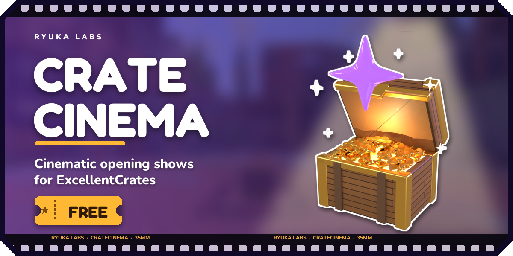
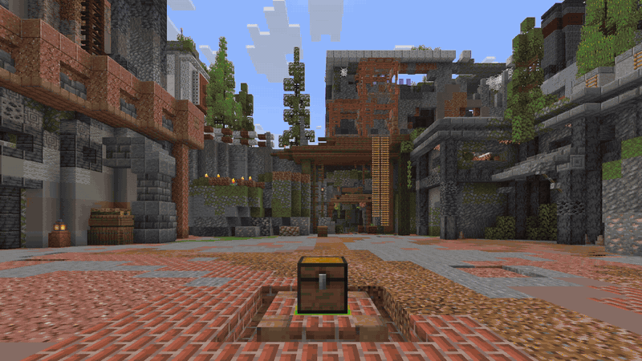
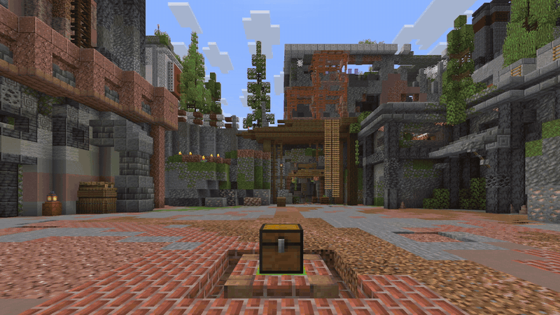
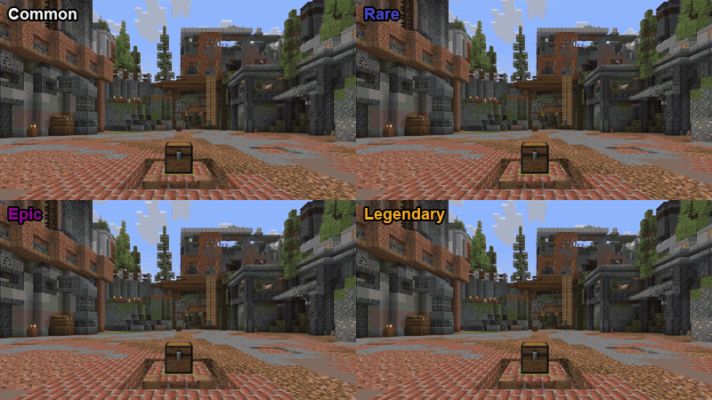

# CrateCinema

Cinematic, in-world opening shows for [ExcellentCrates](https://modrinth.com/plugin/excellentcrates).
The shows are ExcellentCrates animations: pick one for a crate in the crate editor, next to the
built-in ones. Keys, reward pools and costs stay with ExcellentCrates; this plugin only adds the show.

<p>
  
  
</p>

## Features

- **Four shows**: `orbit` (a ring of rewards that spins and narrows down to the winner), `starfall`
  (a meteor strikes the crate), `cards` (shuffled cards, one flips over) and `rift` (a portal tear
  swallows the pool and pushes the reward out). There is also a text-only `simple` show.
- **Rarity tiers**: rarer rewards build up longer, glow in their rarity colour and end bigger.

  

- **Private by default**: only the player opening the crate sees their show, so a crowd can open
  the same crate at once. Showing it to nearby players is one setting.
- **Safe**: ExcellentCrates grants every reward. If a player quits, teleports away or the server
  stops mid-show, the reward is granted at once. Nothing is left in the world after a crash.
- **Bedrock aware**: with Floodgate, Bedrock players get a text-only show they can actually see.
- **Configurable**: each show's settings are ExcellentCrates animation profiles, so one show can
  have several variants. `/cratecinema preview` tries any show at any tier.

## Requirements

- Paper 1.21.9 or newer (ExcellentCrates is dropping Spigot support)
- Java 25 (required by ExcellentCrates 7.x)
- ExcellentCrates 7.2.0 or newer, with nightcore (CrateCinema 1.x works with ExcellentCrates 7.1)

## Getting started

1. Install ExcellentCrates and nightcore, then this plugin, and restart.
2. Set a crate's animation to a show, in the ExcellentCrates crate editor or in the crate's file:
   ```yaml
   animation:
     enabled: true
     profile: cratecinema_starfall:default
   ```
3. Run `/ecrates reload`.

Shows: `orbit`, `starfall`, `cards`, `rift` and the text-only `simple`. Preview any of them in-game
with `/cratecinema preview <show> [tier]`. Everything else, including upgrading from 1.x, is in
[docs/configuration.md](docs/configuration.md).

## Building

```
./gradlew build
```

The plugin jar is written to `build/libs/`. A Java 25 toolchain is provisioned automatically if none is installed.

`./gradlew runServer` starts a local Paper 1.21.9 test server with ExcellentCrates and nightcore downloaded from Modrinth.

Integration tests drive real openings with bots; see [it/README.md](it/README.md).

## License

GPL-3.0. See [LICENSE](LICENSE).

## Help

Questions and ideas are welcome on Discord. Bugs are tracked in GitHub issues.

<p>
  <a href="https://discord.gg/53SRDaZwVN"></a>
  <a href="https://github.com/ryuka-dev/CrateCinema/issues"></a>
</p>

Made by Ryuka. More of my plugins and mods, and how to reach me for custom work: [ryuka.cloud/en](https://ryuka.cloud/en/)
